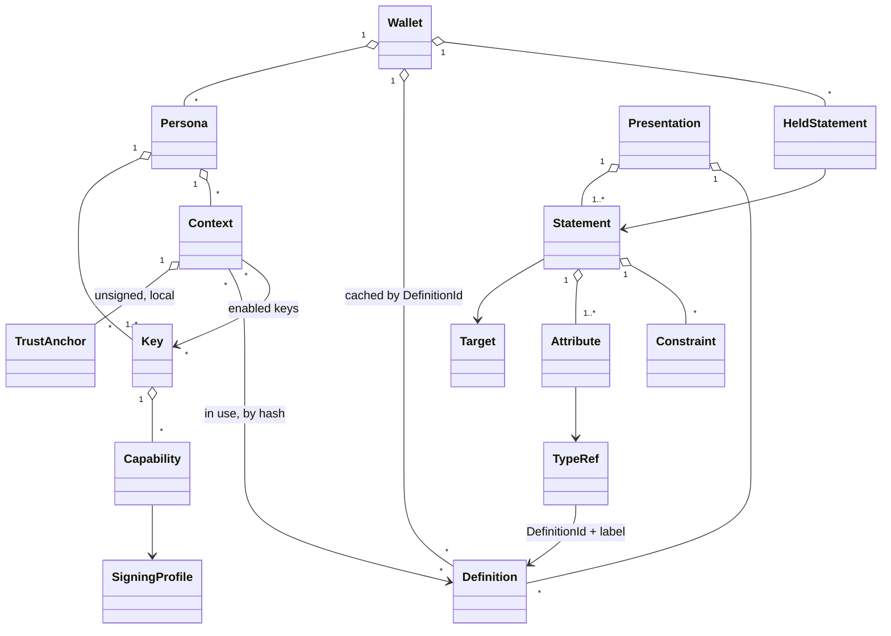

# ARCH-0003 — Wallet, persona, key and definition

**Status: draft.** Drafted from sponsor direction of **2026-10-14**. Nothing here
is accepted. Requirements are numbered `W-NN` so a later ADR can accept them
individually.

ARCH-0001 defines the **statement** and the three procedures over it.
ARCH-0002 defines **whose meanings** a statement carries. This document defines
the layer a person actually uses: **what a wallet holds, and what it does with
it.**

---

## 1. The correction this document starts from

Earlier drafts (PLAN-0002 §2.1, PLAN-0004 §3) named three *personas*: domain
author, issuer, relying party. **Those are not personas. They are roles** — what
one key does in one statement.

| | is | example |
|---|---|---|
| **persona** | an identity a person acts *as* — with its own keys, its own contexts, and its own trust decisions | "Paul, maintainer of m-of-n"; "Paul, anonymous reviewer"; "Paul, personal" |
| **role** | what a key does in *one* statement | defines a vocabulary, makes a claim, delegates, reviews, approves, presents, relies |
| **context** | where, with whom, and about what a persona acts | "m-of-n releases"; "USF CS690 review" |

One persona plays many roles. The same persona's key may sign a definition in
the morning and a claim using it in the afternoon, and review someone else's
claim in a different context. **Role is a property of a statement, not of a
person** — which is exactly what P2 already says: the speaker is a key, and what
the statement *does* is its function.

> Terminology collision, recorded in `GLOSSARY-0001`: the CS690 Product Spec
> template's **user persona** is an archetypal user (Maya, release engineer).
> This document's **persona** is a wallet object. Both are live in PLAN-0002,
> so PLAN-0002 says *archetype* for the template's sense.

---

## 2. The model at a glance



The Apple Wallet analogy holds at the surface and breaks underneath, usefully:

| Apple Wallet | here | the difference |
|---|---|---|
| a card or pass | a **held statement**, rendered as a card | the card's layout and words come from a **definition** anyone can publish, not from Apple's pass format |
| the pass type | a **definition** | identified by the **hash** of its canonical encoding, signed by its author, versioned by hash |
| the issuer (an airline) | the **speaker key**, via its persona | authority is checked by reduction from *your* trust anchors, not by Apple's signing certificate |
| your Apple ID | a **persona** | you hold several; they are unlinkable unless you link them |

---

## 3. Objects

Logical types. Encoding is DEC-002. `?` = optional; `[]` = list.

### 3.1 Wallet

```
Wallet = {
  holder:       LocalName          ; the person's own label; never leaves the wallet
  personas:     [Persona]
  definitions:  { DefinitionId => Definition }   ; content-addressed cache
  held:         [HeldStatement]
  policy:       WalletPolicy       ; defaults: custody, key reuse, disclosure
}
```

The wallet is **local and offline** (APP-0001 §5). It is a container, not a
principal: nothing on the wire names a wallet.

### 3.2 Persona

```
Persona = {
  id:           LocalId            ; wallet-local, never published
  label:        LocalName          ; "maintainer of m-of-n"
  root_key:     KeyId              ; rarely used; signs delegations to operational keys
  keys:         [Key]
  contexts:     [Context]
  linkage:      ? [StatementHash]  ; published statements binding keys to each other
}
```

**A persona is not a principal on the wire.** Outside the wallet it is visible
only as keys, and as whatever linkage statements the holder chooses to publish
("key K1 says key K2 is the same persona"). Two personas that share no key and
no linkage statement are **unlinkable** — the privacy property a human with
several roles in life actually needs.

**Persona key hierarchy is ordinary delegation.** The root key signs
*K_root says K_ops can speak about (Domain, Topic) until T* — P2's delegation
form, nothing new. Rotation is a new delegation; compromise of an operational
key is bounded by the scope and expiry the root gave it.

### 3.3 Key — an object with capabilities

```
Key = {
  id:           KeyId              ; digest of the canonical public-key encoding (RFC 9679 style)
  public:       PublicKey          ; algorithm-tagged
  custody:      file | hardware | derived(seed, path)
  capabilities: [Capability]
  validity:     ? Validity
  successor:    ? KeyId
  state:        active | retired | compromised        ; local record
}

Capability = {
  role:         define | claim | delegate | review | approve | present | external
  profile:      SigningProfile
  scope:        ? { definitions: [DefinitionId], topics: [Label] }
}

SigningProfile = {
  context_tag:  Text               ; domain separation — part of every signed message
  algorithm:    AlgorithmId
  syntax:       native | cose | openpgp | ssh | bitcoin | in-toto | …
}
```

**A key is not just key material.** It carries what this wallet will let it
sign, in which syntax, for which definitions and topics. The wallet **refuses**
to sign outside a key's capabilities (W-03). Externally, a key's authority is
never read from this local record — only from delegation statements, by
reduction (§4).

### 3.4 Context and trust anchors — the trusted context

```
Context = {
  id:           LocalId
  label:        LocalName          ; "m-of-n releases"
  roles:        [Role]             ; what this persona does here
  keys:         [KeyId]            ; keys enabled in this context
  definitions:  [DefinitionId]     ; vocabularies in use here
  anchors:      [TrustAnchor]
  disclosure:   DisclosurePolicy   ; what a presentation from here may reveal
}

TrustAnchor = {                    ; ARCH-0001 AclEntry, scoped to a context
  trusts:       KeyId | Threshold
  about:        { definition: DefinitionId, topics: [Label] }
  constraints:  [Constraint]       ; e.g. only for subjects matching …, only until …
  delegable:    Bool
  decided_at:   Time
}
```

**Trust is per context, not per persona or per wallet.** "I trust Paul's key on
`build-provenance` for m-of-n releases" says nothing about trusting it for email,
or in any other context. Anchors are **unsigned** — nobody said them to you; you
decided them — so they are the fixed floor DEC-008 argues must exist (W-07).

### 3.5 Definition — a vocabulary, schema or protocol, identified by hash

The sponsor's direction: *in the manner of PICS, but **not a URL reference
alone** — the hash of the canonical encoding of the definition.*

```
Definition = {
  body:         DefinitionBody
  id:           DefinitionId       ; = H(canonical(body)) — computed, never asserted
  publication:  ? StatementHash    ; the author's signed statement over id
  locators:     [Locator]          ; hints for retrieval — never identity
}

DefinitionBody = {
  definer:      KeyId              ; the author, inside the hash
  name:         Text               ; "supply-chain"
  version:      Text
  imports:      [DefinitionId]     ; other definitions this one builds on
  entries:      [Entry]
}

Entry = TypeDef | FunctionDef | MessageDef | StateMachineDef | ProfileDef

TypeDef = {                        ; ARCH-0002 P3: a type is a schema
  label:        Label              ; local to the definer (P1)
  representation: Schema           ; structure, cardinality
  values:       ? { Value => Rendering }        ; enumerated, PICS-style
  constraints:  [ConstraintRule]   ; what a conforming use may do (DEC-008 boundary)
  delegation:   same | scoped | none
  names:        { Lang => Text }   ; multilingual
  short:        { Lang => Text }
  long:         { Lang => Text }
  review_tags:  [Label]            ; what a human reviewer should check
}
```

**Identity is the hash; authorship is the signature.** This answers the open
question in ARCH-0002 P4 (*is a domain a signed statement or a bare hashed
artifact?*) with **both, for different jobs**:

| | gives | so a verifier can |
|---|---|---|
| `DefinitionId = H(canonical(body))` | **identity and integrity** of every type, value, rule and word | know it has *exactly* the meanings the issuer used |
| the publication statement, signed by `definer` | **authorship and authority** | ask, by reduction, whether this author is trusted for this vocabulary in this context |
| locators (URL, library record, peer) | **retrieval only** | fetch it — then recompute the hash, and reject on mismatch |

A definition nobody signed can still be cited by hash. It renders as
*unattributed vocabulary*, and no context's trust anchor can make its author
authoritative, because it has none.

**A definition can carry protocols, not only vocabularies.** `MessageDef`,
`StateMachineDef` and `ProfileDef` let a definer publish a message format, a
lifecycle, or an authorization profile (ARCH-0002 P7) under the same hash and
signature. This is what *distributed definition of schemas and protocol
definitions* means concretely — and it is the same artifact set the library's
FX-1 extraction already produces from standards (`docs/extraction.md`), which
makes an extracted standard publishable as a definition.

**Versioning is by hash.** A changed definition is a new `DefinitionId`. The
definer links them with a `supersedes` statement; nothing is edited in place
(W-12).

**The core definition is fixed.** One definition — the statement functions in
§4 — is built into every verifier by hash. It is the floor DEC-008 says cannot
be key-local; every other definition is.

### 3.6 Statement — attributes about a target, with constraints

ARCH-0002 P2's form, *A says B has C*, made explicit:

```
Statement = {
  speaker:      KeyId              ; A — the key; the signature is the saying
  target:       Target             ; B
  attributes:   [Attribute]        ; C — one or more
  constraints:  [Constraint]
  issued:       Time
  context_tag:  Text               ; the signing profile's domain separation
}

Target = digest(alg, value)        ; an artifact
       | locator(uri)
       | description(DefinitionId, value)   ; R-M-11: things you cannot hash
       | key(KeyId)                         ; a statement about a key — delegation, naming
       | statement(StatementHash)           ; a statement about a statement — review, approval

Attribute  = { type: TypeRef, value: Value }
TypeRef    = { definition: DefinitionId, label: Label }
Constraint = validity(from?, until?) | scope(...) | requires(Requirement) | ConstraintRule
```

`TypeRef` carries the **definition hash**, not only the defining key. P1's pair
*(defining key, local label)* still holds — the definer is inside the hashed
body — but the reference now also pins **which version of the meaning** was
used. A statement whose `DefinitionId` the verifier cannot resolve fails the
semantics dimension; it is not skipped (P5, W-10).

### 3.7 Held statement — what the wallet keeps, and why

```
HeldStatement = {
  statement:    SignedStatement    ; exact bytes as received (R-O-05)
  context:      LocalId
  relation:     made | received | about-me | accepted
  acceptance:   ? { verdict: Verdict, under: [TrustAnchor], at: Time }
}
```

*Persona-associated trusted statements* are held statements with relation
`accepted`: a statement this persona checked, in this context, under these
anchors, with this verdict — and decided to rely on. The record of *why* is kept
with it, so trust can be re-examined when an anchor changes.

### 3.8 Presentation

```
Presentation = {
  statements:   [SignedStatement]  ; the claim and its delegation chain
  definitions:  [Definition]       ; so the relying party can render offline
  audience:     ? KeyId
  nonce:        ? Bytes            ; binds to one check; prevents replay
  proof:        ? Signature        ; possession of the presenting key
}
```

---

## 4. Roles and operations

Each role is a **statement function** in the core definition, signed under a
**capability** the key holds, and has a **phase** in the UI (APP-0001 §4b).

| role | operation | statement it produces | target | capability |
|---|---|---|---|---|
| **define** | publish a definition | *K says DefinitionId **is-definition** (name, version)* | the definition's hash | `define` |
| **claim** | make an attestation | *K says B **has** attributes* | artifact, description, key | `claim` |
| **delegate** | grant authority | *K says K′ **can speak about** (definition, topics) under constraints* | a key | `delegate` |
| **review** | give an opinion on a statement | *K says S **reviewed** (outcome, comment)* | a statement | `review` |
| **approve** | authorise a statement | *K says S **approved*** | a statement | `approve` |
| **present** | hand a set to a relying party | a presentation, optionally signed | — | `present` |
| **rely** | check and accept | none — a local acceptance record | — | none: anchors are unsigned |

**Review and approval are different on purpose.** A review is an opinion any key
may give. An approval is an **authorization**: it counts only if its speaker
reduces, from a trust anchor in the relying party's context, to a delegation for
`approve` on that definition (W-08). A definition can require approval —
`requires(approvals ≥ 2 of {reviewers})` — and that is a threshold subject
(ARCH-0001 G4), reduced by the ordinary algorithm.

**Every role is available to every persona.** What stops a persona from approving
its own claim is not a role restriction; it is that no anchor delegates
`approve` to the same key that claimed, which the definition's constraint can
require explicitly.

---

## 5. Lifecycles

**A definition**

```
draft → published (hash fixed, signed) → reviewed → approved
      → adopted (anchored in a context) → superseded (new hash + supersedes)
```

**A claim**

```
draft → signed → presented → reviewed → approved | declined
      → accepted (by a relying party, with a recorded verdict)
      → expired | superseded
```

**A key**

```
created → delegated (by the persona root) → active → rotated (successor) | retired
                                                   → compromised (local record; anchors withdrawn)
```

Revocation as a distributed mechanism remains out of scope (APP-0001 §5); short
validity is the mechanism.

---

## 6. One key, other syntaxes — the Bitcoin question

**Can a key make what other systems would call statements — a Bitcoin
transaction, an SSH signature, an OpenPGP signature?** Cryptographically, yes. A
Bitcoin transaction is *K says "move these coins"*: a signed statement in a
different syntax. A secp256k1 key could sign Bitcoin transactions (BIP-340
Schnorr) and native statements alike.

**The model allows it, as capabilities, under two rules:**

1. **Every signature is domain-separated (W-02).** The signed bytes include the
   signing profile's `context_tag`, so a signature made in one syntax can never
   verify as a statement in another. This is the cross-protocol failure the
   survey records (R-001 §2.5, *context*): nothing in a bare signature binds it to
   a protocol unless it is designed in. DSSE's `payloadType` inside PAE is the
   same move.
2. **Reuse across syntaxes is off by default (W-11).** One key in two protocols
   couples their risk: compromise in one is compromise in both. The default is a
   **derived key per syntax** from one persona seed (`custody: derived`), which
   gives the person one thing to back up and the protocols separate keys.

**And the wallet can read other syntaxes.** A foreign signed object — an in-toto
attestation, a COSE message, a Bitcoin transaction — is imported as an
**external statement** through an interchange profile (ARCH-0001 §6): its
speaker, target and attributes mapped into this model, its original bytes kept.
It can then be checked, delegated over and reasoned about like any other
statement. That is how the same reduction answers *"was this key entitled to
sign this release?"* and *"was this key entitled to spend from this account?"*.

---

## 7. On disk

Extends PLAN-0004 §6. Files, no database.

```
~/.mofn/
  wallet.yaml                      # holder label, policy
  personas/<persona-id>/
    persona.yaml                   # label, root key id, linkage
    keys/<key-id>.key              # encrypted private key (PLAN-0004 §6.1)
    keys/<key-id>.yaml             # public key, capabilities, custody, state
    contexts/<context-id>.yaml     # roles, enabled keys, definitions, disclosure
    contexts/<context-id>/anchors.yaml   # unsigned trust anchors
  definitions/<definition-id>.def  # canonical bytes; filename IS the hash
  statements/<statement-hash>.stmt # exact signed bytes
  held.yaml                        # relation, context, acceptance record per statement
```

A definition's filename is its `DefinitionId`. Loading one recomputes the hash
and refuses a mismatch — the same rule as fetching it from anywhere else.

---

## 8. Requirements — draft

| id | requirement |
|---|---|
| **W-01** | A persona is never a principal on the wire. Principals are keys (P2). Persona linkage is published only as statements, only by choice. |
| **W-02** | Every signature binds its signing profile's `context_tag` into the signed bytes. A signature valid in one profile MUST NOT verify in another. |
| **W-03** | The wallet MUST refuse to sign with a key outside its capabilities. Externally, a key's authority is established only by reduction over delegation statements. |
| **W-04** | A definition is identified by `H(canonical(body))`. A locator MUST NOT identify a definition; a fetched definition whose hash does not match MUST be rejected. |
| **W-05** | Every `TypeRef` carries a `DefinitionId`. A type reference without one is invalid. |
| **W-06** | A definition's author is the key that signed its publication statement, and that key MUST equal `body.definer`. |
| **W-07** | Trust anchors are unsigned, scoped to one context, and never exported. |
| **W-08** | An approval counts only if its speaker reduces, from an anchor in the relying party's context, to a delegation for `approve` on the definition concerned. A review never satisfies an approval requirement. |
| **W-09** | A statement made in a context is signed only with a key enabled for that context. A presentation from a context discloses only statements held in it. |
| **W-10** | An unresolvable `DefinitionId` fails the semantics dimension of the verdict. It is never skipped (P5). |
| **W-11** | Signing in more than one syntax with one key is off by default. Enabling it requires distinct signing profiles and is recorded on the key. |
| **W-12** | Definitions are immutable. A change is a new `DefinitionId`, linked by a `supersedes` statement from the same definer. |

---

## 9. What this changes elsewhere

| document | change |
|---|---|
| ARCH-0001 §4 | additive pointer: the wallet layer is ARCH-0003 (changelog 0.1.2) |
| ARCH-0002 P2 | review and approval added as functions, targeting a statement |
| ARCH-0002 P4 | the open question is answered by §3.5 — identity by hash, authorship by signature |
| APP-0001 | the UI by phase (§4b); "personas" there are roles |
| PLAN-0002 §2.1 | roles, personas and archetypes separated; GAP-1 restated |
| GLOSSARY-0001 | *persona* collision recorded; *role*, *context*, *definition* added |

## 10. Open

1. **Hash algorithm and length.** The prototype truncates to 16 bytes. An
   identifier that carries meaning should be a full, algorithm-tagged digest.
   Tied to DEC-002.
2. **Linkage privacy.** Is a persona-linkage statement ever needed, or does the
   root-key delegation already link everything the root signs? If so, a holder
   who wants unlinkable personas needs unrelated roots.
3. **Selective disclosure** in presentations (SD-JWT, RFC 9901) — out of scope
   this semester; the `disclosure` policy is the hook.
4. **Contract** (DEC-009) — a statement needing more than one speaker. Approval
   thresholds cover part of it; the rest is still unspecified.
5. **External syntaxes beyond read-only.** Importing a Bitcoin transaction as an
   external statement is clear; *making* one from the wallet is a product
   decision, not an architecture one.
