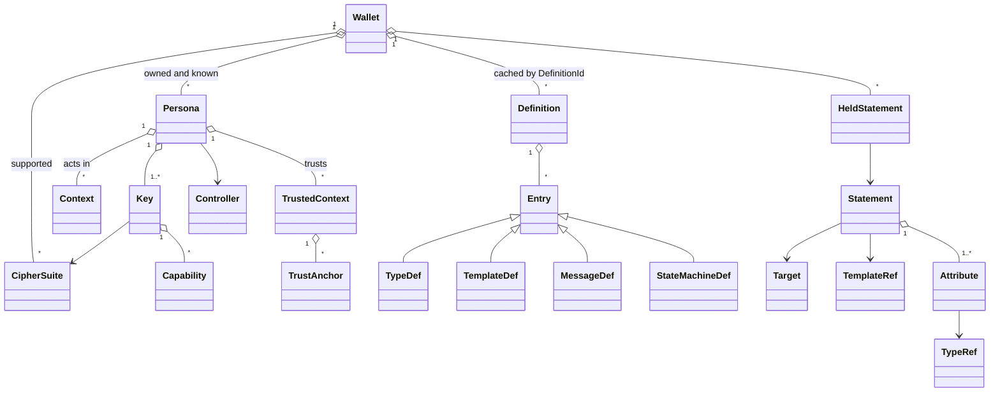
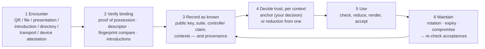

# ARCH-0003 — Wallet, persona, key and definition

**Status: draft.** From sponsor direction of **2026-10-14**. Nothing here is
accepted. Requirements are numbered `W-NN` so an ADR can accept them one at a
time.

ARCH-0001 defines the **statement**. ARCH-0002 defines **whose meanings** it
carries. This document defines what a **wallet** holds and does — and, since a
wallet must learn about other parties before it can believe them, the
**discovery, trust and transport** beneath it.

---

## 1. Definitions this document rests on

> **Persona** — a **key-identified principal**: the key or keys that speak as
> it, together with the **contexts it acts in** and the **contexts it trusts**.
> Its **controller** may be a person, an organisation, a service or script, an
> AI agent, a software implementation, or a hardware device.

> **Wallet** — holds personas. It **owns** (controls) some of them — it holds
> their private keys — and **knows** others: people, services, agents and
> devices whose public keys and statements it has met.

> **Role** — what a persona's key does in **one** statement: define, claim,
> delegate, review, approve, present, rely. A property of the statement, never
> of the persona.

So one persona — say Paul's maintainer key — defines a vocabulary in one
statement, makes a claim with it in another, and reviews someone else's claim
in a third. And the same wallet that owns Paul's personas also holds the
build-bot's persona, the CI server's, an AI release agent's, and David's — as
known personas, with Paul's decisions about what each is trusted for.

> **Correction to v0.1.0.** v0.1.0 made a persona a private, wallet-local
> grouping that "never appears on the wire". That was wrong. **A persona is the
> principal** — the key-centric model's answer to "who" — so it is exactly what
> appears on the wire, and what other wallets hold. Unlinkability is still
> available, but as a choice: separate personas with separate keys.

> **Terminology** (`GLOSSARY-0001`): the CS690 template's *user persona* is
> written **archetype** in PLAN-0002 — a representative user, who will own
> several personas.

---

## 2. The model at a glance



Apple Wallet at the surface: cards you carry, show and check. Underneath, three
differences that are the project:

| Apple Wallet | here |
|---|---|
| Apple defines the pass format | **anyone** publishes a definition; it is identified by hash and authored by a key |
| Apple's certificate decides a pass is genuine | **your trust anchors** decide, per context, by reduction |
| the card's issuer is a company | a **persona** — a person, a server, an AI agent, a device — identified by its key |

---

## 3. Objects

Logical types. Encoding is DEC-002. `?` optional, `[]` list.

### 3.1 Wallet

```
Wallet = {
  owner_label:  LocalName                   ; never leaves the wallet
  personas:     [Persona]                   ; owned and known
  suites:       [CipherSuiteId]             ; suites this wallet can create and verify with
  definitions:  { DefinitionId => Definition }
  held:         [HeldStatement]
  policy:       WalletPolicy                ; suites allowed, key reuse, disclosure, agent rules
}
```

Local and offline (APP-0001 §5). Nothing on the wire names a wallet; a wallet
speaks only through the personas it owns.

### 3.2 Persona — a key-identified principal

```
Persona = {
  id:           KeyId                       ; the identity key's id — this IS the persona
  control:      owned | known               ; owned = this wallet holds the private key
  controller:   ControllerClaim             ; who or what operates the key
  keys:         [Key]                       ; identity key + keys delegated from it
  contexts:     [Context]                   ; where it acts — declared or observed
  trusts:       [TrustedContext]            ; what it trusts — local for owned personas
  descriptor:   ? StatementHash             ; its self-signed persona descriptor
  provenance:   [Discovery]                 ; how this wallet learned of it (§6)
  label:        ? LocalName                 ; the wallet owner's own name for it
}

ControllerClaim = {
  kind:         person | organisation | service | agent | software | device
  asserted_by:  [StatementHash]             ; who says so — itself, or others
}
```

**Identity is the key.** The persona is named by its identity key's `KeyId`, as
SPKI and SDSI name principals. Other keys — per context, per syntax, per device —
are delegated from it by ordinary scoped delegation (ARCH-0002 P2): *K_id says
K_ops can speak about (definition, topics) until T*. Rotation is a new
delegation; a compromised operational key is bounded by the scope and expiry its
identity key gave it.

**The controller is a claim, not a fact.** A persona can say of itself "I am a
service"; that is worth what a self-assertion is worth. Stronger evidence comes
from others: an organisation attesting "this key is our CI service", or a
**device attestation** that the key lives in a TPM or secure enclave (RATS,
RFC 9334; survey R-001 §7). The wallet shows which.

**AI agents are personas, and are never roots.** An agent's authority must
reduce, through delegation, to a persona whose controller is a person or an
organisation (W-15). That is the audit question the 2026 agent-delegation drafts
are reaching for — *which human authorised this?* — answered by the ordinary
reduction.

### 3.3 Cipher suites and keys

A **cipher suite** is an immutable description, per R-0003 §5 — not code, and
not a key generator:

```
CipherSuite = {
  id:           CipherSuiteId               ; what statements cite
  signature:    AlgorithmId                 ; e.g. Ed25519, ECDSA-P256, ML-DSA-65
  hash:         AlgorithmId
  sizes:        { public_key, signature, hash }
  encoding:     { public_key: Name, signature: Name }
  signed_bytes: Name                        ; the rule producing the exact signed bytes
  key_exchange: ? { kem, kdf, aead }        ; EMPTY until a transport needs it (§7)
}

Key = {
  id:           KeyId                       ; digest of the canonical public key (RFC 9679 style)
  suite:        CipherSuiteId               ; exactly one
  public:       PublicKey
  custody:      ? file | hardware | derived(seed, path) | remote-signer   ; owned keys only
  capabilities: [Capability]
  validity:     ? Validity
  successor:    ? KeyId
  state:        active | retired | compromised
}

Capability = {
  role:         define | claim | delegate | review | approve | present | transport | external
  context_tag:  Text                        ; domain separation, inside every signed message
  syntax:       native | cose | openpgp | ssh | bitcoin | in-toto | …
  scope:        ? { definitions: [DefinitionId], topics: [Label] }
}
```

**A wallet supports several suites** — classical and post-quantum side by side
(survey R-001 §10: ML-DSA where verification is decades away, Ed25519 where
size matters). Each key belongs to **exactly one** suite, every statement cites
its suite, and sign and verify refuse a key whose suite does not match (R-0003;
W-18).

**One key, several uses.** A key's capabilities say what the wallet will let it
sign, in which context and syntax. Each use is **domain-separated** (W-02): a
signature made as a review can never verify as an approval, and one made as a
Bitcoin transaction can never verify as a statement. Reuse across syntaxes is
**off by default** (W-11) — a derived key per syntax from one seed gives one
backup and separate risk.

### 3.4 Contexts, and what a persona trusts

```
Context = {                                 ; where a persona acts
  id:           LocalId | StatementHash     ; published contexts are statements
  label:        Text                        ; "m-of-n releases"
  roles:        [Role]
  keys:         [KeyId]
  definitions:  [DefinitionId]
  disclosure:   ? DisclosurePolicy
}

TrustedContext = {                          ; what a persona trusts, and for what
  context:      Context
  anchors:      [TrustAnchor]
}

TrustAnchor = {                             ; ARCH-0001 AclEntry, scoped to a context
  trusts:       KeyId | Threshold
  about:        { definition: DefinitionId, topics: [Label] }
  constraints:  [Constraint]
  delegable:    Bool
  decided:      { at: Time, because: Text }
}
```

A persona **acts in** contexts — which may be published, as statements by its
key: *"I sign releases for m-of-n."* A persona **trusts** in contexts — and for an
owned persona those anchors are the wallet owner's decisions: **unsigned, per
context, never exported** (W-07). They are the fixed floor DEC-008 says cannot
be key-relative.

### 3.5 Definitions — identified by hash, authored by signature

The sponsor's direction: *in the manner of PICS, but not a URL reference alone —
the hash of the canonical encoding of the definition.*

```
Definition = {
  body:         DefinitionBody
  id:           DefinitionId                ; = H(canonical(body)) — computed, never asserted
  publication:  ? StatementHash             ; the definer's signed statement over id
  locators:     [Locator]                   ; retrieval hints only
}

DefinitionBody = {
  definer:      KeyId                       ; inside the hash
  name:         Text
  version:      Text
  imports:      [DefinitionId]
  entries:      [Entry]
}

Entry = TypeDef | TemplateDef | MessageDef | StateMachineDef | ProfileDef
```

| | gives | so a verifier can |
|---|---|---|
| `DefinitionId` | identity and integrity of every type, value, rule and word | know it has *exactly* the meanings the issuer used |
| publication statement, by `definer` | authorship and authority | decide, by reduction, whether this author is trusted for this vocabulary |
| locators — URL, library record, peer, transport | retrieval | fetch it, recompute the hash, and reject a mismatch |

This answers ARCH-0002 P4's open question — *signed statement, or bare hashed
artifact?* — with **both, for different jobs**. A definition nobody signed can be
cited, and renders as *unattributed vocabulary*.

`TypeDef` is ARCH-0002 P3 (representation, permitted values, constraints,
delegation type, multilingual names and descriptions, review tags).
`MessageDef`, `StateMachineDef` and `ProfileDef` let a definer publish a
**protocol** — message formats, a lifecycle, an authorization profile — under
the same hash and signature. That is what *distributed definition of schemas and
protocol definitions* means here, and it is the artifact set the library's FX-1
extraction already produces from standards.

**Versions are hashes.** A change is a new `DefinitionId`, linked by a
`supersedes` statement from the same definer (W-12). **The core definition** —
the statement functions of §4 and the transport messages of §7 — is built into
every verifier by hash: the DEC-008 floor.

### 3.6 Templated statements

A **template** is the unit a person actually issues from — "release
attestation", "record reviewed". It is a definition entry, so it is published,
hashed and authored like any other:

```
TemplateDef = {
  label:        Label                       ; "release-attestation"
  function:     attest | delegate | review | approve
  target:       { kind: TargetKind, rules: [ConstraintRule] }   ; e.g. digest, sha-256 only
  attributes:   [ { type: TypeRef, required: Bool, fixed: ? Value, default: ? Value } ]
  constraints:  { max_validity: ? Duration, approvals: ? Threshold, scope: ? [ConstraintRule] }
  issuer:       { capability: Role, delegated_topic: ? Label }  ; who may issue from it
  sentence:     { Lang => Text }            ; "{issuer} attests that {target} was built {build-provenance}"
}
```

**Issuing** is filling a template: the wallet lists templates from definitions
adopted in a context, generates the form from the template (no
template-specific UI code), and signs. **Validating** adds one check to the
verdict: the statement must **conform to its template** — required attributes
present, fixed values unchanged, target rules met, validity within the maximum.
That is P5's *expected* level, and a statement that fails it is rejected even if
it is signed and authorised (W-17).

### 3.7 Statement

ARCH-0002 P2's form, *A says B has C*:

```
Statement = {
  speaker:      KeyId                       ; A
  suite:        CipherSuiteId
  template:     ? TemplateRef               ; { definition: DefinitionId, label }
  target:       Target                      ; B
  attributes:   [Attribute]                 ; C
  constraints:  [Constraint]
  issued:       Time
  context_tag:  Text
}

Target    = digest(alg, value) | locator(uri) | description(DefinitionId, value)
          | persona(KeyId) | statement(StatementHash)
Attribute = { type: TypeRef, value: Value }
TypeRef   = { definition: DefinitionId, label: Label }
```

`TypeRef` pins the **definition hash** as well as the label. P1's pair (defining
key, local label) still holds — the definer is inside the hashed body — and the
version of the meaning is now pinned too. An unresolvable `DefinitionId` fails
the semantics line of the verdict; it is never skipped (W-10).

### 3.8 Held statements and presentations

```
HeldStatement = {
  statement:    SignedStatement             ; exact bytes as received (R-O-05)
  context:      Context
  relation:     made | received | about-owned-persona | accepted
  acceptance:   ? { verdict: Verdict, under: [TrustAnchor], at: Time }
}

Presentation = {
  statements:   [SignedStatement]           ; the claim and its chain
  definitions:  [Definition]                ; so the relying party can render offline
  personas:     [StatementHash]             ; descriptors and introductions needed to discover the speakers
  audience:     ? KeyId
  nonce:        ? Bytes
  proof:        ? Signature
}
```

*Persona-associated trusted statements* are held statements with relation
`accepted`, kept with **why**: the verdict and the anchors it was accepted under,
so trust can be re-examined when an anchor changes.

---

## 4. Roles

| role | statement | target | capability |
|---|---|---|---|
| **define** | *K says DefinitionId is-definition (name, version)* | a definition hash | `define` |
| **claim** | *K says B has attributes* — usually from a template | artifact, description, persona | `claim` |
| **delegate** | *K says K′ can speak about (definition, topics) under constraints* | a persona | `delegate` |
| **review** | *K says S reviewed (outcome, comment)* | a statement | `review` |
| **approve** | *K says S approved* | a statement | `approve` |
| **introduce** | *K says K′ has name / controller / context* (ARCH-0002 P6) | a persona | `claim` |
| **present** | a presentation | — | `present` |
| **rely** | none — a local acceptance record | — | none: anchors are unsigned |

**Review is an opinion; approval is an authorization.** An approval counts only
if its speaker reduces, from an anchor in the relying party's context, to a
delegation for `approve` on that definition (W-08). A template may require
approvals — `approvals: 2 of {…}` — which is a threshold subject (ARCH-0001 G4).

---

## 5. Lifecycles

```
Definition  draft → published (hash fixed, signed) → reviewed → approved
                  → adopted in a context → superseded (new hash + supersedes)

Statement   template chosen → filled → signed → presented → reviewed → approved | declined
                  → accepted (with recorded verdict) → expired | superseded

Persona     encountered → verified (possession, binding) → known
                  → trusted in a context (anchor, or reduction from one)
                  → key rotated (successor) | retired | compromised (anchors withdrawn, acceptances re-checked)
```

---

## 6. Key discovery and trust — the full dataflow

A wallet cannot believe a statement from a persona it has never met, and must
not believe one merely because it has now met it. **Discovery never confers
trust** (W-14).



| step | what happens | where trust can enter — and where it must not |
|---|---|---|
| **1 Encounter** | the public key arrives: scanned in person, attached to a file or presentation, **introduced** by a persona already known (*K says K′ has name "build-bot"*), found at a directory or `.well-known` locator or a transparency log, carried by the transport (§7), or accompanied by a device attestation | **none yet.** A locator, a directory and a log are retrieval, exactly as for definitions |
| **2 Verify binding** | **proof of possession**: the persona signs a fresh nonce; its **descriptor** — a self-signed statement of controller kind, suites, contexts and endpoints — verifies; the owner may **compare fingerprints** out of band; introductions are checked as statements | establishes *this key is controlled by whoever answered*, not *who that is* |
| **3 Record** | stored as a **known persona**, with **provenance**: how, when and from whom it was learned (W-16) | none — known ≠ trusted |
| **4 Decide trust** | **directly** — the owner adds an anchor in a context (*trust K for build-provenance in m-of-n releases*) — or **derived**: a chain from an existing anchor reduces to it | the only place trust enters, and always per context |
| **5 Use** | statements from it are checked; the verdict names the chain | — |
| **6 Maintain** | a **rotation** (successor statement from the identity key) moves trust to the new key; **expiry** ends it; marking a key **compromised** withdraws anchors and re-checks every acceptance made under them — which is why acceptances record their anchors | a successor statement is believed only if the old key was trusted for rotation |

**Introductions are how trust scales without a central root.** Paul's wallet
trusts the m-of-n maintainer persona. The maintainer introduces the build-bot
and delegates `build-provenance` to it. A relying party that anchors only the
maintainer now believes the build-bot's releases — **and only those**, until the
delegation expires — with no directory, no CA, and no step where discovery
itself conferred trust.

---

## 7. Transport — would it help? Yes, as a thin, untrusted layer

**Statements protect themselves.** Integrity and authenticity come from the
signature, so the channel adds nothing to *whether to believe* a statement, and
the verdict is identical however it arrived (W-19). A transport is for three
other things: **delivery**, **confidentiality**, and **request–response
workflows** — review requests, approvals, introductions, proof-of-possession
challenges — which a file on a USB stick does badly.

| transport | gives | cost | for |
|---|---|---|---|
| **files, QR, clipboard** | offline, zero infrastructure | manual | the **Nov 11 floor** — already planned |
| **wallet-to-wallet mailbox** | store-and-forward between wallets; messages **encrypted to the recipient persona's key** (HPKE, RFC 9180) and addressed by `KeyId`; the relay is untrusted and sees only ciphertext and a recipient id | one small relay; the suite's `key_exchange` part becomes non-empty — the session protocol R-0003 deferred to | **CS Night**: two laptops, a review request and an approval crossing between them |
| **secure email** | reach — nothing new to install; email is also our own original scenario (Alice/Bob/Carol/Dave delegating over `*@foo.com`) | S/MIME and OpenPGP clients are heavy; we would carry presentations, not reimplement either | **stretch**: a presentation as a MIME attachment (`application/mofn-presentation`) |

**Recommendation:** files and QR for the floor; the **mailbox** as the transport
for CS Night if W-1 lands on time; email as a carrier only, as a stretch.

**Wallet-to-wallet transactions are a protocol, so they are a definition.** The
messages — `Introduce`, `PossessionChallenge` / `PossessionProof`,
`ReviewRequest` / `ReviewResponse`, `ApprovalRequest` / `Approval`,
`PresentationOffer` — and their state machine are published as `MessageDef` and
`StateMachineDef` entries in the core definition, identified by hash like any
other. The transport is the first protocol the project defines **with its own
mechanism**.

---

## 8. Demonstrating templated issuance and validation

Two definitions, one engine, one set of screens. Each step names what it proves.

| # | step | proves |
|---|---|---|
| 1 | Paul's maintainer persona **publishes** the supply-chain definition with a `release-attestation` template; the wallet shows its `DefinitionId` | definitions are identified by hash and authored by a key |
| 2 | the maintainer **introduces** a build-bot persona (controller: `service`) and **delegates** `build-provenance` for m-of-n until Friday | personas of any controller kind; scoped, expiring authority |
| 3 | the build-bot **issues from the template** — the form is generated from the definition | templated issuance, no template-specific code |
| 4 | the release is **presented** to a second wallet — file, or mailbox if built | transport is untrusted and interchangeable |
| 5 | the second wallet, anchoring only the maintainer, **discovers** the build-bot through the introduction, and the verdict is **✔** with the chain shown | discovery → trust by reduction, not by directory |
| 6 | the build-bot issues for a **different project** → **authorization ✘** *"no standing: delegation covers m-of-n only"* | the product moment: signed, but not entitled |
| 7 | a statement with a **required attribute removed** → **expected ✘** *"does not conform to release-attestation"* | template conformance is checked |
| 8 | the template requires **one approval**: a reviewer persona **reviews**, which does not satisfy it; an approver persona **approves**, which does | review ≠ approval |
| 9 | the same steps on the archives definition (`record-reviewed`) — same screens | the vocabulary claim generalises |
| 10 | Wi-Fi off throughout steps 1–9 except 4-by-mailbox | no CA, no registry, no network in the verdict |

---

## 9. On disk

```
~/.mofn/
  wallet.yaml                                # owner label, policy, supported suites
  personas/<key-id>/                         # owned AND known personas; dir name is the identity KeyId
    persona.yaml                             # control, controller claim, label, provenance
    keys/<key-id>.yaml                       # public key, suite, capabilities, state
    keys/<key-id>.key                        # encrypted private key — owned personas only
    contexts/<context>.yaml                  # where it acts
    trusts/<context>.yaml                    # unsigned anchors — owned personas only
  definitions/<definition-id>.def            # canonical bytes; filename IS the hash
  statements/<statement-hash>.stmt           # exact signed bytes
  held.yaml                                  # relation, context, acceptance record
  outbox/  inbox/                            # transport, if enabled
```

---

## 10. Requirements — draft

| id | requirement |
|---|---|
| **W-01** | A persona is identified by its identity key. A wallet holds owned personas (with private keys) and known personas (public only), and treats both as principals. |
| **W-02** | Every signature binds its capability's `context_tag` into the signed bytes. A signature valid for one role or syntax MUST NOT verify for another. |
| **W-03** | The wallet MUST refuse to sign with a key outside its capabilities. Externally, a key's authority is established only by reduction. |
| **W-04** | A definition is identified by `H(canonical(body))`. A locator MUST NOT identify a definition; a fetched definition whose hash does not match MUST be rejected. |
| **W-05** | Every `TypeRef` and `TemplateRef` carries a `DefinitionId`. |
| **W-06** | A definition's author is the key that signed its publication statement, and MUST equal `body.definer`. |
| **W-07** | Trust anchors are unsigned, scoped to one context, and never exported. |
| **W-08** | An approval counts only if its speaker reduces to a delegation for `approve` on the definition concerned. A review never satisfies an approval requirement. |
| **W-09** | A statement made in a context is signed only with a key enabled for it; a presentation discloses only statements held in that context. |
| **W-10** | An unresolvable `DefinitionId` fails the semantics line of the verdict. It is never skipped (P5). |
| **W-11** | Using one key in more than one syntax is off by default; enabling it requires distinct capabilities and is recorded on the key. |
| **W-12** | Definitions are immutable; a change is a new `DefinitionId` linked by `supersedes` from the same definer. |
| **W-13** | A controller kind is a claim. The wallet shows who asserts it — the persona itself, another persona, or a device attestation. |
| **W-14** | Discovering a persona MUST NOT confer trust. Trust enters only through an anchor or a reduction from one. |
| **W-15** | A persona whose controller is `agent` cannot be a trust anchor's root of authority by default; its authority must reduce to a person or organisation persona. Wallet policy may relax this, and the relaxation is shown. |
| **W-16** | Every known persona records its discovery provenance: how, when, and through whom. |
| **W-17** | A statement citing a template MUST conform to it — P5's *expected* level — or be rejected, whatever its signature and authorization. |
| **W-18** | Each key belongs to exactly one cipher suite; a statement cites its suite; sign and verify refuse a mismatch (R-0003). |
| **W-19** | The verdict is independent of transport. Channel encryption provides confidentiality only, never trust. |

---

## 11. What this changes elsewhere

| document | change |
|---|---|
| ARCH-0001 §4.4 | additive pointer to this layer (changelog 0.1.2) |
| ARCH-0002 P2, P4 | review and approval as functions; P4's question answered by §3.5 |
| APP-0001 §4b | UI by phase, including *Discover & trust* and *Inbox* |
| PLAN-0002 §2.1 | roles, personas and archetypes separated |
| R-0003 | the suite's `key_exchange`, deferred "until a session protocol exists", is needed exactly when §7's mailbox is |
| GLOSSARY-0001 | persona, role, context, definition, capability, template |

## 12. Open

1. **Is a persona one identity key, or a set of peer keys with no root?** This
   draft says one identity key with delegated keys. A peer set (*k*-of-*n* control,
   ARCH-0001 G4) is the natural generalisation for organisations, and would make
   a persona's identity a threshold.
2. **Hash algorithm and length** for `KeyId`, `DefinitionId` and statement
   hashes — the prototype truncates to 16 bytes; a meaningful identifier should be
   a full, algorithm-tagged digest. Tied to DEC-002.
3. **Directory and `.well-known` discovery** — useful for reach, and a privacy
   cost; how much of a persona's descriptor is published.
4. **Selective disclosure** in presentations (SD-JWT, RFC 9901) — the
   `disclosure` policy is the hook; out of scope this semester.
5. **Contract** (DEC-009) — a statement needing several speakers. Approval
   thresholds cover part of it.
6. **Making external-syntax objects** (a Bitcoin transaction) from the wallet,
   rather than importing them — a product decision, not an architecture one.
