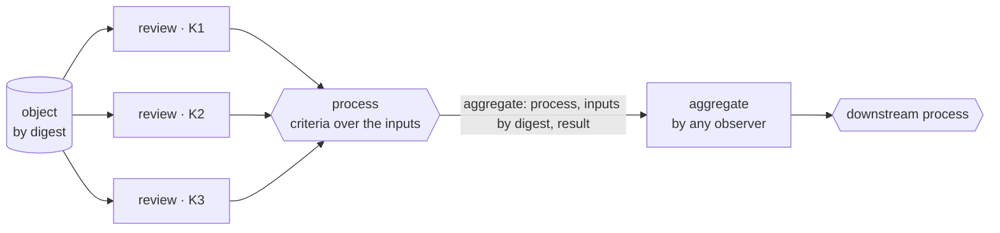

# KSA Processes — panels, criteria and reproducible aggregates

**Specification SPEC-0005 · version 0.1.0 · draft**

## Abstract

Statements are objects in a dataflow, acted on by keys. This document specifies
how a definition declares that flow. A **panel** names the keys entitled to
speak about an object on one topic — typically reviewers. A **process** names its
inputs, a declarative **criteria** rule over them (such as *two distinct
approvals and no rejection within 48 hours*), the words that explain its outcome,
and the processes downstream that consume it. Evaluating a process is
deterministic, so its result — an **aggregate** statement citing every input by
digest — is believed only because any observer can recompute it.

## Status of this document

Draft for review in the m-of-n project. Realises ARCH-0003 §3.9–§3.10 and
requirements W-20–W-24. Panels and processes are entries of a definition
(SPEC-0003 §4.1, entry types 3 and 4) and inherit its identity, authorship and
human-readable-semantics rules.

---

## 1. Introduction

A signed review is an opinion. Most real decisions need more: *two of these
three reviewers approve, nobody rejects, within two days* — and then something
downstream acts on the decision. Systems that do this today either hide the rule
inside a service, so a relying party must trust the service, or fix it in a
format for one domain, as the in-toto layout does for software builds.

KSA puts the rule **in the definition**, beside the vocabulary it uses: published
by a key, identified by hash, written so a person can read it, and evaluable by
anyone. Its result is an ordinary statement that names the rule and every input,
so it can be checked rather than trusted.

## 2. Conventions and terminology

The key words "MUST", "MUST NOT", "REQUIRED", "SHALL", "SHALL NOT", "SHOULD",
"SHOULD NOT", "RECOMMENDED", "NOT RECOMMENDED", "MAY", and "OPTIONAL" in this
document are to be interpreted as described in BCP 14 [RFC2119] [RFC8174] when,
and only when, they appear in all capitals, as shown here.

| term | meaning |
|---|---|
| **panel** | a definition entry naming the keys that may speak on one topic (§4) |
| **process** | a definition entry declaring inputs, a criteria rule, an explanation and downstream consumers (§5) |
| **object** | the target the process is about — usually an artifact or a statement, by digest |
| **input statement** | a statement that qualifies as an input of a process for an object (§6.1) |
| **aggregate** | a `kind 11` statement reporting a process's result (SPEC-0002 §8.11) |
| **observer** | any party that evaluates a process, signed or not |

## 3. Overview



A definition contains a panel (who may review), templates (what a review
says — SPEC-0003 §7) and a process (what counts). Reviewers sign reviews of the
object. Any observer evaluates the process over the reviews it holds and may sign
an aggregate. A relying party believes the aggregate only after recomputing it.

## 4. Panels

### 4.1 Structure

```
panel-def = {
  1 label:   label,
  2 names:   language-map,
  3 short:   language-map,
  ? 4 long:  language-map,
  5 members: [1, [+ kid]]          ; a listed set
           / [2, kid],             ; every key the named key has delegated this topic to
  6 topic:   local-type-ref        ; the type members speak about, e.g. a review outcome
}
```

### 4.2 Membership

At evaluation time `t`, a key `M` is a **member** of a panel if:

- **listed** (`[1, keys]`): `M` is in the list; or
- **delegated** (`[2, D]`): the statement set holds a verified trust statement by
  `D` with `this = [1, M]`, valid at `t`, not revoked (SPEC-0004 §7.1), whose
  `about` includes an attribute range of the panel's `topic` type.

Delegated membership uses only `D`'s direct trust statements. It does not follow
further delegation, and it does not depend on the relying party's anchors:
membership is a fact about the definition and the statement set. Whether the
relying party cares about the definition, or about `D`, is trust evaluation.

### 4.3 Distinctness

Where criteria count members, each member counts once. Two keys linked by a
rotation (SPEC-0004 §7.2) are one member. A party that controls two unlinked
keys is two members unless the panel's author prevents it; a listed panel makes
this the author's responsibility, and a delegated panel makes it `D`'s.

## 5. Processes

### 5.1 Structure

```
process-def = {
  1 label:      label,
  2 names:      language-map,
  3 short:      language-map,
  ? 4 long:     language-map,
  5 inputs:     [+ input-def],
  6 rule:       criteria,
  7 explain:    language-map,          ; how the outcome is described, met or not
  ? 8 downstream: [+ process-ref-local]
}
input-def = {
  1 name:     label,                   ; how the rule refers to this input
  2 kinds:    [+ kind-code],           ; e.g. [9] review, [10] approve, [11] aggregate
  ? 3 template: local-type-ref,        ; if present, inputs MUST conform to it
  4 from:     label,                   ; a panel in this definition
  ? 5 process: process-ref-local       ; for kind 11: the upstream process
}
process-ref-local = { ? 1 definition: DefinitionId, 2 label: label }
```

### 5.2 Criteria

A criteria rule is an array whose first element is an operator code. `where` is
an expression of SPEC-0003 §8.2 evaluated against each input statement's
attributes, in which a path `[label]` names the attribute of that label.

| code | form | holds when |
|---|---|---|
| 1 | `[1, input, k]` or `[1, input, k, where]` | at least `k` distinct members (§4.3) each have an input statement of that input that satisfies `where` |
| 2 | `[2, [+ criteria]]` | every listed rule holds |
| 3 | `[3, [+ criteria]]` | at least one holds |
| 4 | `[4, criteria]` | the rule does not hold |
| 5 | `[5, input, where]` | **no** input statement of that input satisfies `where` |
| 6 | `[6, input, seconds]` | the input statements counted by the other rules of the same `[2, …]` were all issued within `seconds` of one another (by `valid.issued`) |

Where one member has several input statements of the same input, the one with
the latest `valid.issued` is used and the others are ignored — a reviewer's
latest word counts.

### 5.3 Human-readable semantics

`names`, `short` and `explain` are REQUIRED (SPEC-0003 §9). A renderer reporting a
process outcome MUST show `explain`, followed by the counts the evaluation found
for each threshold rule: *"Needs 2 approvals from release reviewers and no
rejection within 48 hours — found 1 approval, 0 rejections."*

## 6. Evaluation

### 6.1 Input statements

For process `P` of definition `Δ`, object `X`, statement set `S` and evaluation
time `t`, a statement `s` is an **input statement** of input `i` if:

1. `s` is verified (SPEC-0002 §9) and in `S`;
2. `s.kind` is in `i.kinds`;
3. `s.this` equals `X`;
4. `s.says` is a member at `t` of the panel named by `i.from` (§4.2);
5. `s` is valid at `t` and not revoked;
6. if `i.template` is present, `s` names that template and conforms to it
   (SPEC-0003 §7.1);
7. if `s` is an aggregate (kind 11), its `process` is `i.process` and it is itself
   accepted under §6.3.

### 6.2 Result

`P` is **met** for `X` at `t` if its rule holds over the input statements. The
result is a deterministic function of (`Δ`, `X`, `S`, `t`): every conforming
observer MUST compute the same result from the same inputs.

### 6.3 Accepting an aggregate

An aggregate `a` (SPEC-0002 §8.11) for process `P` and object `X = a.this`,
citing inputs `D = a.inputs` and reporting `a.result`, is **accepted** by an
evaluator at time `t` if and only if:

1. the evaluator obtains every statement whose digest is in `D`, and each is an
   input statement of `P` for `X` at `t` (§6.1);
2. evaluating `P`'s rule over exactly those statements gives `a.result`; and
3. evaluating `P`'s rule over those statements **together with every input
   statement the evaluator itself holds** also gives `a.result`.

Condition 3 means an aggregate cannot hide an input: an aggregate reporting *met*
while the evaluator holds a qualifying rejection that the aggregate did not cite
is not accepted. **An aggregate that does not recompute is rejected, whoever
signed it** (ARCH-0003 W-21). Who signed it is recorded as provenance only.

### 6.4 Processes and trust evaluation

When a template requires a process (`approval`, SPEC-0003 §7), SPEC-0004 §10.2
item 4 is satisfied if `P` is met for the statement's target at the evaluation
time, computed by the evaluator under §6.2 — an aggregate is a convenience that
saves gathering the inputs, never a substitute for the rule.

## 7. Downstream and acyclicity

`downstream` names the processes that consume this process's aggregates. The
graph whose nodes are processes `(DefinitionId, label)` and whose edges are
`downstream` references and `input.process` references MUST be acyclic; a
definition that creates a cycle within itself does not conform. Because
cross-definition references are by DefinitionId and a definition cannot reference
one that does not yet exist, cycles can only arise within one definition.

## 8. Bounds

An evaluator MUST support processes with up to 64 inputs, panels of up to 256
listed members, and criteria up to 16 deep, and MAY reject larger ones. It MAY
bound the number of input statements it considers per input, and if it does and
the bound is reached the result is **not met** with reason `work-bound`.

## 9. Security considerations

### 9.1 Hidden inputs

§6.3 condition 3 stops an aggregator omitting an
unfavourable input that the evaluator holds. It cannot reveal an input the
evaluator has not received; a relying party that matters SHOULD gather inputs from
more than one source before relying on a negative-sensitive rule (rule 5).

### 9.2 Panel capture

A delegated panel is as sound as its delegator. A process
whose panel is `[2, D]` hands its outcome to whoever `D` delegates to; relying
parties SHOULD treat that as trusting `D`.

### 9.3 Cross-object replay

A review counts only for the object it names (§6.1
item 3), so a review of one release cannot be reused for another.

### 9.4 Time windows

Rule 6 uses `valid.issued`, the speaker's own claim.
Reviewers who backdate can defeat it; where that matters, inputs need external
timestamps (SPEC-0001 §11).

## 10. Privacy considerations

Reviews and aggregates name their speakers and the object. A panel listing keys
publishes its membership. A process evaluated locally reveals nothing.

## 11. Registries

**Criteria operators** — §5.2, append-only as SPEC-0002 §12.

## 12. References

[RFC2119], [RFC8174]; [SPEC-0002]; [SPEC-0003]; [SPEC-0004]. Informative:
in-toto layout specification; [ARCH-0003] §3.9.

---

## Appendix A. Example — release review

Definition `release-review`, definer the m-of-n maintainer, extending DV-1's
`outcome` type (imported):

```yaml
definer: '0x21fe31df…'                      # the maintainer
name: release-review
version: "1"
imports: ['0x517007656a617b3b…']            # DV-1 (supply-chain), for its `outcome` type
entries:
  - template:
      label: review
      function: review
      target: {types: [digest]}
      attributes: [{type: {definition: '0x5170…', label: outcome}, required: true}]
      max validity: 1209600                 # 14 days
      sentence: {en: "{says} reviewed release {this}: {outcome.name}."}
      names: {en: Release review}
  - panel:
      label: release-reviewers
      names: {en: Release reviewers}
      short: {en: The keys the maintainer has delegated release review to.}
      members: {delegated by: '0x21fe31df…'}
      topic: {definition: '0x5170…', label: outcome}
  - process:
      label: release-approval
      names: {en: Release approval}
      short: {en: Two reviewers approve and nobody rejects, within 48 hours.}
      inputs: [{name: reviews, kinds: [review], template: review, from: release-reviewers}]
      rule:
        all:
          - threshold: {input: reviews, k: 2, where: {outcome: approve}}
          - none:      {input: reviews, where: {outcome: reject}}
          - within:    {input: reviews, seconds: 172800}
      explain: {en: "Needs 2 approvals from release reviewers and no rejection within 48 hours."}
```

Three members review release `sha-256:48dfc395…`: two `approve`, one `changes`.
Two observers evaluate independently and each finds *met* — two distinct
approvals, no rejection, all issued within 48 hours — and each may sign an
aggregate citing the same three review digests. An aggregate citing only one
approval, or citing the two approvals while the evaluator holds a third member's
`reject`, is not accepted (§6.3).
